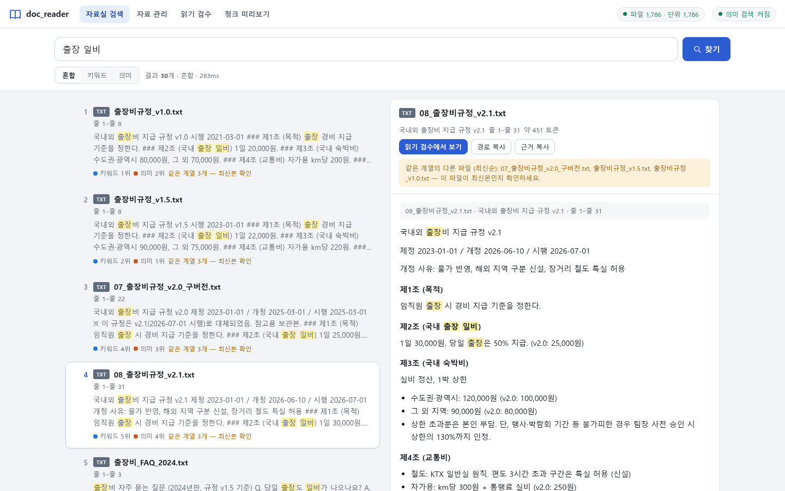
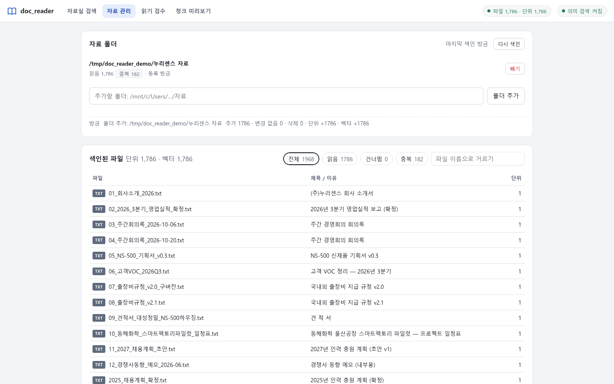
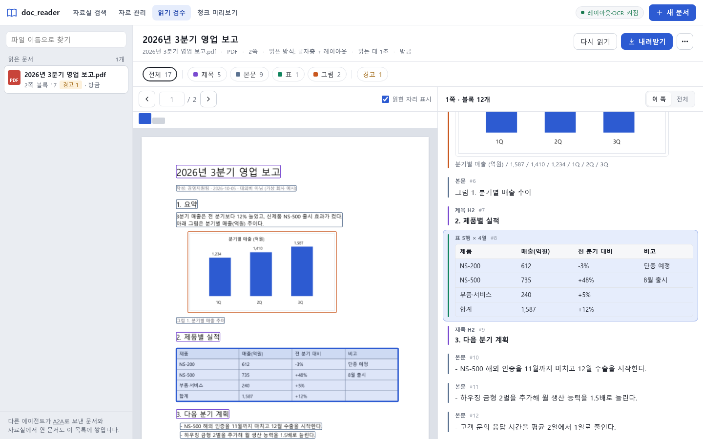
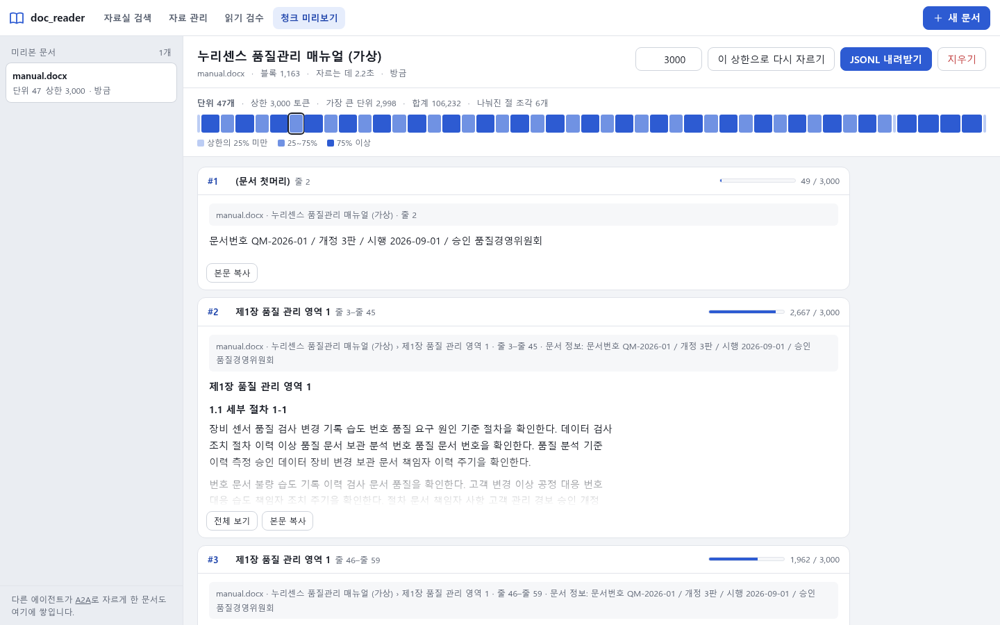
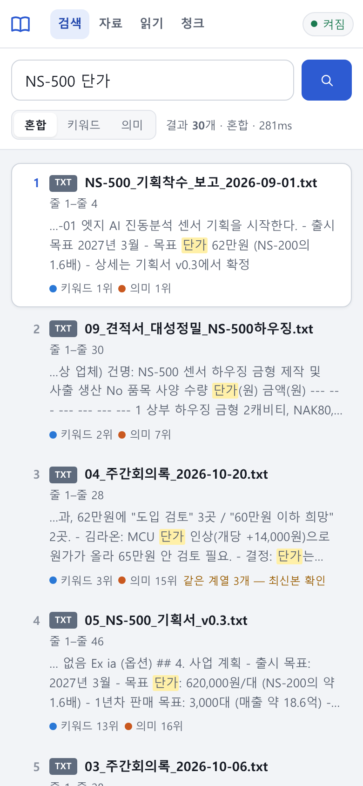

# doc_reader — 읽기 에이전트

문서를 **읽고**(doc_parser) → 검색 단위로 **자르고**(doc_chunker) → 자료 폴더에서 근거를 **찾는**(doc_index) 에이전트입니다.
문서를 쓰는 [doc_writer](https://github.com/Taeksu-Kim/doc_writer)의 짝으로, 라이터가 쓸 근거를 리더가 읽고 찾아 줍니다.
한국어 업무 문서(PDF·Word·Excel·PowerPoint·텍스트)를 기준으로 만들었고, 모델 없이도 동작합니다(레이아웃·OCR·의미 검색은 선택).

*A reading agent for Korean business documents: parse (blocks with page positions, tables, figures; optional layout/OCR),
chunk along document structure, and search folders with Korean keyword + vector hybrid search. One local server with a
review UI and one A2A (Agent2Agent 1.0) agent; each component is also a plain Python library.*



같은 기능을 세 가지로 씁니다.

| 쓰임 | 어떻게 |
|---|---|
| **화면** | `python -m doc_reader serve` → http://127.0.0.1:8767 — 자료실 검색 · 자료 관리 · 읽기 검수 · 청크 미리보기 |
| **A2A** | 같은 서버의 에이전트 카드 하나(`/.well-known/agent-card.json`), `POST /a2a` — 다른 에이전트가 읽기·자르기·검색을 맡김 |
| **import** | `from doc_parser import parse_file` · `from doc_chunker import chunk` · `from doc_index import Index` |

## 빠른 시작

Python 3.10 이상.

```bash
git clone https://github.com/Taeksu-Kim/doc_reader && cd doc_reader
python -m pip install --config-settings editable_mode=compat -e ./doc_parser -e ./doc_chunker -e ./doc_index
python -m pip install -e .
python -m doc_reader serve            # http://127.0.0.1:8767 (이 PC 안에서만 열림)
```

- 부품 셋은 `editable_mode=compat`으로 설치합니다. 저장소 루트의 `doc_parser/` 폴더가 같은 이름의 패키지를 가리지 않게 하려는 것입니다.
- 처음 열면 **자료실 → 자료 관리**에서 찾을 폴더를 등록합니다. 색인이 끝나면 검색할 수 있습니다.
- 데이터는 `doc_reader/data/`(영역별 하위 폴더)에 쌓입니다. `--data`로 바꿀 수 있습니다.

선택 기능(꺼져 있어도 서버는 뜨고 그 기능만 잠깁니다):

| 옵션 | 켜면 | 서버 |
|---|---|---|
| `--embed-url URL` | 의미 검색(혼합·의미 방식). 없으면 키워드로 찾음 | OpenAI 호환 `/v1/embeddings` (예: Qwen3-Embedding을 vLLM이나 CPU 서버로) |
| `--model-url URL` | PDF 읽기의 **그림 영역 구분**(레이아웃)·**스캔·이미지 글자 읽기**(OCR) | [`doc_parser/tools/ocr_server.py`](doc_parser/tools/ocr_server.py) (PaddleOCR-VL + PP-DocLayoutV3, GPU 약 5.4GB) |

## 화면

네 화면이 같은 상단 바를 씁니다. 첫 화면은 자료실 검색입니다.

### 자료실 검색 (`/library/#/search`)
- 찾을 말을 넣고 **혼합 · 키워드 · 의미** 중 방식을 고릅니다. `/` 키로 검색창, ↑/↓로 결과 이동.
- 결과마다 **파일 · 장·절 경로 · 쪽(줄) 범위**, 검색어 강조, **찾은 방식**(키워드 n위 · 의미 n위)이 나옵니다.
- 같은 문서의 다른 버전(`출장비규정_v1.0` / `v2.1` / `_구버전`)이 있으면 **"같은 계열 — 최신본 확인"** 경고가 붙습니다.
- 결과를 고르면 오른쪽에 근거 전체(표는 표로)가 나오고, **읽기 검수에서 보기**를 누르면 그 파일의 해당 쪽이 열립니다.

### 자료 관리 (`/library/#/library`)


- 폴더를 추가하거나 뺍니다. 바뀐 파일만 다시 읽는 **증분 색인**이고, 사라진 파일은 색인에서 빠집니다.
- 색인 진행과 기록(추가 · 변경 없음 · 삭제 · 벡터)을 보여 주고, 파일별 상태(읽음 · **건너뜀과 이유** · 중복)를 거를 수 있습니다.
- 임베딩 서버가 꺼져 있으면 키워드만 색인합니다. 나중에 켜고 **다시 색인**하면 빠진 벡터가 채워집니다.

### 읽기 검수 (`/read/`)


- 파일을 끌어다 놓으면 바로 읽습니다. PDF는 **원본 페이지 위에 블록이 읽힌 자리**를 종류별 색 상자로 겹쳐 보여 줍니다.
- 블록을 누르면 페이지의 자리가, 페이지의 상자를 누르면 블록이 선택됩니다. 제목 · 본문 · 표 · 그림 · 경고로 거를 수 있습니다.
- 쪽 띠: 막대 높이는 그 쪽의 블록 수, 주황은 경고가 있는 쪽입니다. ←/→로 쪽 이동.
- **다시 읽기**로 레이아웃·OCR을 켜고 끄며, **내려받기**로 마크다운 · 블록(JSONL) · 그림 PNG를 받습니다.
- 같은 파일을 같은 방식으로 다시 넣으면 새로 읽지 않고 이전 결과를 엽니다. 다른 에이전트가 보낸 문서도 목록에 쌓입니다.

### 청크 미리보기 (`/chunk/`)


- 문서를 상한(기본 3,000 토큰)으로 잘라 **단위 지도**(칸 너비 = 토큰 수, 진하기 = 상한 대비)와 단위 목록을 보여 줍니다.
- 단위마다 `파일 · 문서 › 장 › 절 · 쪽` 머리와 문서 정보(시행일 · 버전)가 붙고, 큰 표는 행 단위로 자르며 머리 행을 반복합니다.
- 상한을 바꿔 다시 자르면 이전 결과가 남아 비교할 수 있고, JSONL로 내려받습니다.



휴대폰 폭에서도 씁니다(상단 바는 짧은 이름, 근거는 결과를 누르면 전체 화면).

## A2A — 다른 에이전트가 쓰기

[A2A 1.0](https://a2a-protocol.org) JSON-RPC. 에이전트 하나(`doc_reader`)에 기능 4개가 있습니다.

| skill | 입력 | 결과 (artifacts) | `metadata.reviewUrl` |
|---|---|---|---|
| `parse-document` | 파일: `{raw, filename}` · `{url: "file:///절대경로"}` · data `{path}`. 옵션 data `{layout, ocr}` | `markdown` · `blocks` · `figures` | 읽기 검수 화면 |
| `chunk-document` | 위와 같은 파일 + data `{max_tokens}` | `units` | 청크 미리보기 화면 |
| `search-documents` | text = 찾을 말, 옵션 data `{mode: hybrid\|keyword\|vector, k}` | `hits` | 같은 검색을 연 화면 |
| `add-folder` | data `{folder: "/절대경로"}` | `build` (색인 결과) | 자료 관리 화면 |

메시지는 `data.skill`로 기능을 고릅니다. 없으면 내용으로 정합니다: 폴더 → `add-folder`, 파일 + `max_tokens` → `chunk-document`,
파일 → `parse-document`, 글만 → `search-documents`. 결과의 `reviewUrl`로 사람이 같은 일을 화면에서 확인하고 이어서 고칠 수 있습니다.

```python
import json, urllib.request

def a2a(method, params, url="http://127.0.0.1:8767/a2a"):
    body = json.dumps({"jsonrpc": "2.0", "id": 1, "method": method, "params": params}).encode()
    req = urllib.request.Request(url, body, {"Content-Type": "application/json"})
    return json.load(urllib.request.urlopen(req))

msg = {"role": "ROLE_USER", "messageId": "m1", "parts": [{"text": "출장 일비"}, {"data": {"k": 5}}]}
task = a2a("SendMessage", {"message": msg})["result"]["task"]
print(task["status"]["state"], task["metadata"]["reviewUrl"])        # TASK_STATE_COMPLETED http://127.0.0.1:8767/library/#/search?q=…
for h in task["artifacts"][0]["parts"][0]["data"]["hits"]:
    print(h["name"], h["loc_start"], " › ".join(h["heading_path"]))
```

- 기본은 끝날 때까지 기다립니다. `configuration: {"returnImmediately": true}`면 바로 돌려받고 `GetTask`로 확인합니다.
- `GetTask` · `ListTasks`(contextId·상태로 거르기) · `CancelTask`는 세 영역의 작업을 함께 봅니다. 스트리밍·푸시 알림은 없습니다.
- 서버는 127.0.0.1에만 열립니다(같은 PC의 에이전트용). 파일 경로를 받으므로 외부에 열지 마세요.

## import — 코드에서 쓰기

```python
from doc_parser import parse_file
doc = parse_file("보고서.pdf")                      # ParsedDoc(title, blocks, warnings, …)
for b in doc.blocks:                                # Block(type="heading"|"text"|"table", loc, text, rows, image, bbox)
    print(b.loc.label(), b.render()[:80])           # "p.3", 마크다운

from doc_chunker import chunk
units = chunk(doc, max_tokens=3000)                 # [Unit(heading_path, loc_start, loc_end, text, tokens, part)]

from doc_index import Index, OpenAICompatEmbedder
idx = Index("index.sqlite", OpenAICompatEmbedder("http://localhost:8011/v1"))   # 임베더 없이 Index("index.sqlite")면 키워드만
idx.build(["자료폴더/"])                              # 증분
hits = idx.search("출장 일비", k=10)                  # mode="hybrid" | "keyword" | "vector"
```

각 부품의 규칙·옵션·측정은 부품 README: [doc_parser](doc_parser/README.md) (형식별 처리, OCR·레이아웃 옵션과 실측, 일괄 추출) ·
[doc_chunker](doc_chunker/README.md) (청킹 규칙, 긴 문서 회귀) · [doc_index](doc_index/README.md) (한국어 키워드 처리, 검색 정확도 측정).

## 구성

```
doc_reader/
  doc_reader/    서버 하나: 화면 3개 + A2A 창구 (app.py · read.py · chunk.py · library.py · static/)
  doc_parser/    읽기: 파일 → 제목·본문·표·그림 블록(쪽·위치), 선택 레이아웃·OCR. 공용 A2A 배관 doc_parser.a2a
  doc_chunker/   자르기: 블록 → 구조 단위(머리·문서 정보), 큰 표는 머리 행 반복
  doc_index/     찾기: 키워드(한국어 2글자 BM25) + 벡터 + 혼합(RRF), SQLite 한 파일, 증분
  tests/         서버 E2E · tools/ 브라우저 점검과 README 캡처(screenshots.py)
```

의존 방향은 doc_index → doc_chunker → doc_parser이고, 서버(doc_reader)는 셋 위에 있습니다. 각 부품의 상태(작업 대기열·SQLite)는
그 부품의 `service.py`에 있고, 서버는 화면·API·A2A만 얹습니다. 영역 사이(자료실 → 읽기 검수)는 서버 안에서 함수로 잇습니다.

## 검증

```bash
python -m pytest -q                             # 서버 E2E 11개 (읽기 3 · 자르기 3 · 찾기 4 · 에이전트 전체 1), 모델·임베딩만 가짜
(cd doc_parser && python -m pytest -q)          # 부품 E2E — doc_parser 13 · doc_chunker 3 · doc_index 3
python tools/check_read.py [PDF]                # 실제 Chromium으로 눌러 보기 — 읽기 40 · 자르기 24 · 찾기 38개, 폭 3종·다크
python tools/check_chunk.py
python tools/check_library.py
python tools/screenshots.py                     # README 캡처 (가상 자료)
```

브라우저 점검은 [Playwright](https://playwright.dev/python/)와 Chromium이 필요합니다. 2026-11-15에 위 검사를 모두 통과했습니다.
캡처의 자료는 모두 가상입니다(가상 회사 '누리센스' 문서 묶음, 가상 보고서·매뉴얼).

## 알려진 한계 (요약)

- 실제 한국어 여러 쪽 보고서·실제 스캔본은 일부만 확인했습니다(디자인 도구로 만든 1쪽 서식 15개, 영문 논문 원본·스캔본). 2단 편집 PDF의 읽기 순서는 섞일 수 있습니다.
- 검색은 구버전·잠정본을 스스로 걸러내지 못해 "같은 계열" 경고로 알립니다. 리랭커는 없습니다.
- 자세한 한계는 각 부품 README의 "알려진 한계"에 있습니다.

## 라이선스

[Apache License 2.0](LICENSE). 단, PDF 처리는 **[PyMuPDF](https://github.com/pymupdf/PyMuPDF)(AGPL-3.0 또는 Artifex 상용 라이선스)**에
의존합니다. 이 저장소의 코드는 Apache 2.0이지만, PyMuPDF와 함께 배포하거나 네트워크 서비스로 제공하는 경우에는 PyMuPDF의
라이선스 조건이 함께 적용됩니다. 자세한 내용은 [NOTICE](NOTICE)를 보세요.

## 이 PC에서 (작성자 환경 메모)

- WSL2 + conda 환경 `stock-dataset`(Python 3.12)에 부품을 editable(compat)로 설치해 씁니다. 저장소 위치는 `side_projects/doc_reader/`이고,
  예전 위치 `side_projects/doc_parser` · `doc_chunker` · `doc_index`는 이 폴더를 가리키는 링크입니다(2026-11-15에 묶음).
- 레이아웃·OCR 서버: `bash doc_parser/tools/ocr.sh start|stop|status` (conda 환경 `paddleocr` + `vllm`, 주소는 WSL IP:8090). 상세는 doc_parser README.
- `serve`의 `--model-url` · `--embed-url` 기본값은 이 PC의 WSL IP(8090 · 8011)입니다.
- 이전 저장소(Taeksu-Kim/doc_parser · doc_chunker · doc_index)는 보관 처리했습니다.
